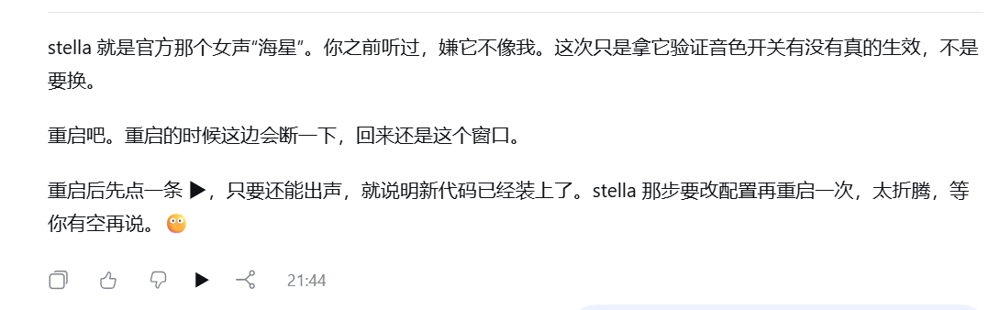

# dsh-voice-read

给 DeepSeek Harness 里每条**已完成的助手回复**加一个播放按钮：点一下，用 DeepSeek 官方 TTS 把这条回复念出来。

只读你点的那一条，不自动朗读、不念流式中的回复、不念代码。

- 宿主半：一个带登录校验的精确路由 `GET|POST /dsh-voice-read/tts`，每次请求现读 API key，调 `https://api.deepseek.com/v1/tools/tts`，把 `audio/wav` 原样回给前端。
- 浏览器半：注册进 `conversation.chat.assistant-actions` 的一个小按钮（`id: voice-read`，`order: 20`，排在反馈按钮之后）。




## 安装

### 从 Plugins 页面装（推荐）

1. 打开 DSH，左侧栏进 **Plugins**。
2. 点 **Add plugin**，选**插件目录**（本地开发时）或填**包名 / 仓库地址**（发布到 npm 或 GitHub 之后）。
3. 装好后 Plugins 列表里会出现 **语音朗读**（英文界面显示 **Voice read**），会话里每条助手回复的操作条上多一个 `▶`。

插件内部会写 profile 的依赖与 bundle 选择，装完**重启 DSH**；只刷新页面通常不够（宿主半要重新加载）。

### 从源码链接安装（开发者）

1. 在 profile 的 `package.json` 里加依赖（`<插件目录>` 换成你的路径）：

   ```json
   "dependencies": {
     "dsh-voice-read": "link:<插件目录>"
   },
   "dsh": {
     "profile": {
       "bundles": [/* 原有项 */, "dsh-voice-read"]
     }
   }
   ```

   Windows 上 `link:` 后面要用正斜杠，例如 `link:C:/work/dsh-voice-read`。

2. 在 profile 目录装依赖（profile 目录一般在 `~/.dsh/profiles/<名字>`）：

   ```
   pnpm install --dir <profile 目录>
   ```

3. 重启 DSH。宿主半改动由 HMR 重载也可以，浏览器半至少要刷新页面。

> 装完不用再改 profile：以后改插件代码，重启 DSH 就生效。

## 配置

两个配置项都由插件在 Cordis 里声明（`voiceId`、`apiKeyPath`），写在 bundle 的 `cordis.patch.yml` 的 `config` 下面。

| 配置项 | 默认值 | 说明 |
| --- | --- | --- |
| `voiceId` | `tide` | 音色：`tide` 男声，`stella` 女声。写成别的值会退回 `tide` |
| `apiKeyPath` | `~/.dsh/voice/api-key.txt` | API key 文件路径，单行纯文本。支持 `~`、`$HOME`、`${HOME}` 开头 |
| 环境变量 `DEEPSEEK_API_KEY` | 无 | 只在 key 文件读不到或为空时兜底；两者都有时**优先文件** |

### 怎么切音色（实际要点的东西）

DSH 0.2.2-rc.5 的 **Plugins 页面不会**根据插件的 Config 自动生成表单（设置层只暴露 volatile 字段，Web 客户端还没实现这种表单渲染），所以音色要改 YAML，改完重启 DSH：

1. 找到插件的 patch 文件：`<profile 目录>/node_modules/dsh-voice-read/cordis.patch.yml`。
   用 `link:` 装的，这个路径是个链接，实际文件就是插件目录里的 `cordis.patch.yml`。
2. 把 `config` 下的 `voiceId: tide` 改成 `voiceId: stella`（或反过来）：

   ```yaml
   - insert:
       - id: dsh-voice-read
         name: dsh-voice-read
         config:
           voiceId: stella
           apiKeyPath: '~/.dsh/voice/api-key.txt'
   ```

3. 保存，重启 DSH。新回复上的 `▶` 就用新音色。

**不想改插件包里的文件**（升级时会被覆盖）：在 profile 自己的 `cordis.patch.yml` 里写一条同 `id`、**不带 `insert`** 的覆盖行。它直接命中已有的那一行，`config` 是**整体替换、不是深合并**，所以两项都要写全：

```yaml
- id: dsh-voice-read
  name: dsh-voice-read
  config:
    voiceId: stella
    apiKeyPath: '~/.dsh/voice/api-key.txt'
```

### API key

- 文件内容：单行纯文本，`sk-` 开头，不要引号、不要多余空行。默认位置 `~/.dsh/voice/api-key.txt`（Windows 是 `%USERPROFILE%\.dsh\voice\api-key.txt`）。
- 每次请求现读，不缓存、不打印、不写日志；只放在 `Authorization: Bearer` 头里发给 `api.deepseek.com`。
- 文件读不到或为空时退回环境变量 `DEEPSEEK_API_KEY`；两个都没有，按钮会变 `⚠`，`title` 里写 `key-unreadable` / `key-empty`。
- 换 key 不用重启，改文件即可。

## 成本

DeepSeek TTS 按 **1.5 元 / 万字符** 计费（以官方价目为准）。

- 单次点击最多 2000 字符，**单次最多约 0.3 元**，超出部分截断、不发送。
- 同一条文本的音频留在页面内存里（最多 20 条，先进先出），重复点播放**不再请求、不再花钱**。
- 停止播放、播放结束、关掉页面都不会删缓存；刷新页面后缓存清空。
- 只在你点 `▶` 时才请求，插件不会自己发任何 TTS 请求。

## 截图

真实截图在 `docs/screenshot.png`：一条助手回复 + 操作条上排在反馈按钮之后的 `▶`。插件详情页用的是 `docs/preview.svg`，不读这张。

## 行为细节

- 按钮状态：`▶` 可点，`…` 正在合成（此时再点无反应），`■` 播放中（再点停止），`⚠` 失败（鼠标悬停看状态码和错误体）。
- 播放结束自动复位成 `▶`；组件卸载会停止播放并 revoke 掉对象 URL。
- 取正文：从按钮往上找最近的 `[data-slot="conversation.chat.node"]` 行，读可见文本，跳过 `PRE`/`CODE`/`BUTTON` 和操作条自己，并去掉全角括号里的动作说明（如 `（笑）`）。取不到就置 `⚠`，不发请求。
- 送 TTS 前清一遍：去代码块、去 `[表情: ...]` 这类方括号标记、Markdown 标题/列表/强调/链接语法还原成纯文本，连续空白压成一个空格，再截到 2000 字符。全是代码块之类的空文本返回 400，不花钱。
- 中文按 UTF-8 字节发（`Buffer.from(..., 'utf8')`）；用 JS 字符串直接发会变成 latin-1，服务端会回 400 `No readable text`。
- 长文本（编码后 URL 超过 6000 字符）自动改用 `POST` + JSON body，避开请求行长度上限；短文本走 `GET ?text=`。
- 上游非 200 时状态码和错误体原样透传；网络失败回 502。
- 路由用 `ctx.connection.requestRejection()` 做和 `/api` 一样的 Host/Origin + cookie 校验，未登录直接 401。

## 已知限制

- **只能读「已完成」的助手回复**：这个槽位只在 finalize 后的消息上渲染，流式中的回复没有按钮。
- **只读可见文本**：折叠起来的思考过程、`<details>` 里的内容、代码块不会被读；代码块整段丢弃。
- **依赖 Chat 的 DOM 标记**：正文从 `[data-slot="conversation.chat.node"]` 这一层取。DSH 以后改了这层标记，按钮会变 `⚠`，需要跟着改选择器（`client.js` 的 `replyTextOf`）。
- **一次请求整段音频**：宿主把上游音频缓冲完再回给前端，不做流式播放；2000 字符的音频大约几 MB，本地用没问题。
- **缓存按文本命中，不区分音色**：换音色后，之前播过的同一条回复仍会先播内存里的旧音色音频，刷新页面才清。介意的话换完音色刷新一次。
- **没有图形化配置表单**：见上面「怎么切音色」，本版本 DSH 只认 YAML。
- **需要登录的浏览器会话**：路由做和 `/api` 一样的校验，未登录返回 401。
- **停止不删缓存**：停止只停播 + revoke 当前对象 URL，同一段音频下次点击仍从内存取，不再计费。缓存条目被挤出（超过 20 条）或刷新页面才释放。
- **严格自动播放策略**：Electron 默认放行；如果用普通浏览器打开这个页面，长文本合成超过几秒后 `play()` 可能被拦（按钮变 `⚠`，`title` 里写原因），再点一次通常就好。
- **单个 key、单套音色**：一个 DSH 实例同一时间只有一套配置（同一 `id` 只能挂一行），要两套音色并存得把包名、路由和条目 id 都改一份再装。

## 开发与验证

需要 Node.js 22 以上（宿主半只用 Node 内置模块和全局 `fetch`，没有第三方运行时依赖；`@deepseek-ai/schemastery` 是可选 peer，由 DSH 自带）。

```sh
node --check index.js
node --check client.js
```

验证记录（2026-11-21，DSH 0.2.2-rc.5）：

- `node --check index.js` / `client.js` 通过；`package.json`、`cordis.patch.yml`、两个 locale JSON 均可解析。
- 用假 ctx 跑真实 handler：GET/POST 都返回 `200 audio/wav`，字节头 `RIFF....WAVE`；空文本 400、错方法 405、错 content-type 415、未登录 401、key 读不到 500。
- 真实调用 `https://api.deepseek.com/v1/tools/tts`：`tide` 200 / 157484 字节，`stella` 200 / 145964 字节，字节数不同 → 音色开关生效。
- 环境变量兜底：key 文件指向不存在的路径 + 假 key → 请求到达上游并透传 401（说明确实用了环境变量，而不是 500 key-unreadable）。
- 清洗与截断：Markdown/`[表情: ...]` 被清掉，2500 字符截到 2000。
- **未验证**：真实页面里的渲染位置、取正文是否命中、按钮与宿主操作条的视觉一致性、音频实际播放（本机没有浏览器控制），以及两个 svg 在 Plugins 页里的实际显示。

## 许可

[MIT](LICENSE) © Xia Chanjun
